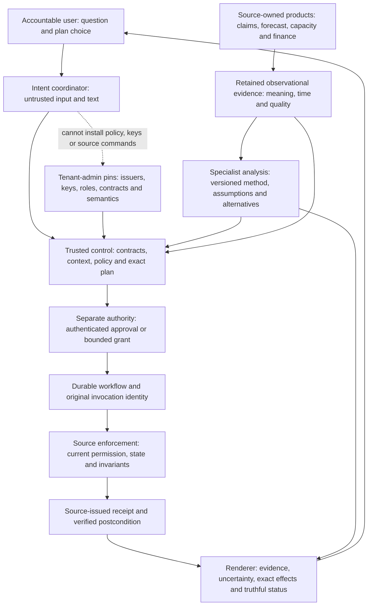
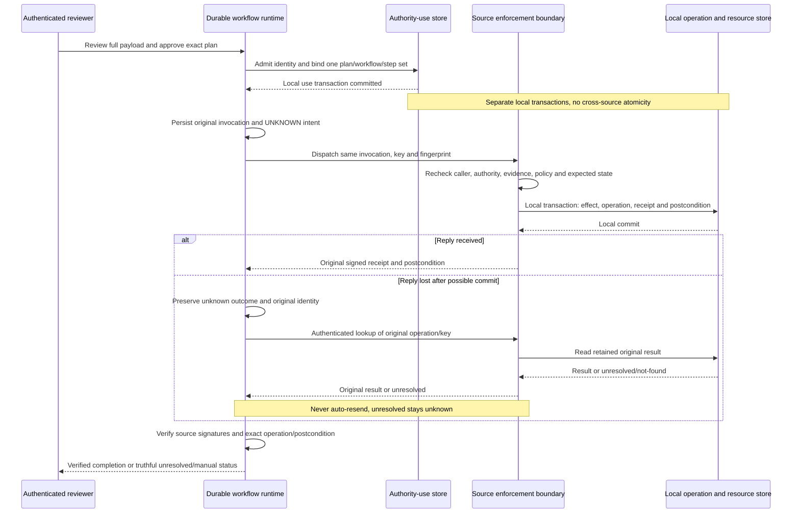
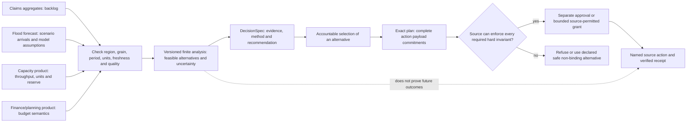

# Architecture and trust boundaries

APS-DDA v0.1 is a **language-neutral proposed participation profile**. The .NET/C# projects implement an experimental selected binding, not complete conformance. Read [the paper](whitepaper.md), [coverage and gaps](implementation-status.md), [runtime guarantees](reference-binding.md) and the [concrete API contract](../API_CONTRACT.md) before integrating. New source development was AI-assisted; no external security assessment or human expert sign-off is implied.

## 1. Proposed ecosystem, not an installed product topology

The architectural objective is to avoid an unnecessary **new analytical replica and disconnected decision/action layer** for bounded supported workflows. It is not to prohibit analytical services, historical products, materialization or governed copies, and it is not merely to put an agent in front of local CRUD.

A participant publishes a source-owned DataProduct and/or ProcessCapability. The coordinator locates tenant-approved contracts and assembles evidence. Specialist services perform reproducible analysis with explicit method/parameter/input versions. The trusted control plane checks context, meaning and policy, binds an immutable exact plan, admits and consumes separate authority, and coordinates source actions. Sources retain facts and enforce their own commands. The renderer displays evidence, uncertainty, alternatives, exact approved effects, receipts and unresolved status; it is not a shadow system of record or authority issuer.

[Participant-boundary Mermaid source](diagrams/participant-boundaries.mmd) is the editable diagram source. It describes the proposed responsibility split, not a claim that this checkout installs every depicted service.

MCP, A2A or native HTTPS can carry these artifacts and delegation mechanics. The original specification's MCP `2026-07-28` and A2A `v1.0` references are pinned historical design anchors, not latest-version claims. The reference Core/Runtime has no MCP/A2A adapter. Protocol connectivity is neither intrinsically incapable nor sufficient by itself to establish domain meaning, plan-bound business authority or source effects.

## 2. Actual reference modules

| Module | Responsibility | Important boundary |
| --- | --- | --- |
| `ApsDda.Core` | Strict JSON, embedded unchanged original schema, immutable artifacts, exact references, JCS projections/digests, experimental P-256 detached signatures, tenant trust pins | Parse/shape validation is not integrity/trust/permission; crypto verification is not authority |
| `ApsDda.Runtime` | File-backed artifact/evidence/workflow/authority-use/operation storage; trusted principal handles; evidence/policy/authority checks; finite runner and source adapter contracts | Store/admin APIs do not authenticate callers; production host must protect reads and provisioning |
| `SqliteSourceAdapter` | Reviewed source-local command, exact local version and capacity guard, durable operation/receipt/postcondition with the effect | Source-owned local transaction only; a wrapper cannot manufacture remote source atomicity |
| HTTP host/client module | Authenticated transport boundary over the same runtime contracts | Separate module and tests; Core/Runtime counts do not establish host authentication or production identity integration |
| Insurance demo/compiler module | Synthetic analytical walkthrough and derived presentation artifacts | Separate module and tests; not a standardized insurance profile, live integration, actuarial validation or deployed app |

The last two rows are integration boundaries, not delivery claims. Their actual status must be taken from the separately recorded final evidence in [implementation status](implementation-status.md).

The Core uses the full [original schema](../spec/original/aps-dda.schema.json) embedded in the installed assembly. No network or current-directory lookup is needed. Historical procurement fixtures are shape examples with placeholder digests, not runtime inputs. Actual runtime artifacts have computed digests and detached signatures; immutable corrections create new artifacts rather than changing historical content.

## 3. Three different kinds of trust

**Origin/integrity:** exact references and hashes bind declared bytes; independently pinned issuing keys authenticate their source. The runtime must require the actual configured source issuer for receipts and evidence, not any participant with a compatible role.

**Caller/source permission:** a host first authenticates an identity, then resolves an administrator-provisioned immutable principal handle. Incoming context is compared with that handle and intersected with source resource, capability, audience, purpose, tenant, role, classification and residency permissions. `ResolveAuthenticated` is not login. Unsupported delegation is refused.

**Business authority:** `PolicyDecision` is evaluated evidence, including `allow`; it is not a grant. An authenticated independent approver or permitted PolicyGranter admits an exact plan-bound Approval/Authority. One durable use binding precedes effects. Per-step dispatch and commit revalidate time, revocation, policy, evidence and source permission. Admission, signature verification and consumption are distinct operations.

Trust and principal directories are locally configured in process and must be provisioned again after restart from trusted administration. Durable runtime policy and local artifact/key/issuer revocation rows do survive reopening, but there is no remote propagation guarantee or production key service. Do not provision pins from request claims or discovery responses.

## 4. Integrity and payload commitments

`artifact_core` removes only `/header/contentDigest`. `plan_core` removes only `/header/contentDigest` and `/body/planDigest` from the complete ExecutionPlan. Both include every other header/body field, extensions and ordered steps. Compute plan digest first (43-character unpadded base64url SHA-256), then content digest (`sha256:` and lowercase hexadecimal). Detached signatures and mutable runtime status remain outside the immutable artifact.

Original plans and invocations contain payload digests, not raw payloads. This selected runtime retains a separately supplied normalized `JsonObject` payload for each exact step. Its documented experimental invocation fingerprint binds complete context, exact capability, source audience, target, complete payload, expected state and idempotency domain. The approval view must render the full retained payload—not merely an opaque digest or different redacted executable effect. Future regional allocation commands must bind regional allocation fields; an aggregate capacity quantity alone does not prove regional assignment.

The strict parser refuses duplicate decoded names, invalid Unicode/UTF-8, non-finite and unsafe-magnitude numbers. The .NET JCS binding supports object/array roots and a narrower safe-number input profile. Exact precision values use profile-defined strings; identifiers are matched exactly rather than normalized into authorization equivalence. The full signature/fingerprint bytes are documented in [API_CONTRACT.md](../API_CONTRACT.md).

## 5. Local transactions, lost replies and recovery

The authority-use transaction binds one authority to one correlation UUID, plan digest and allowed step set. It commits **before** source dispatch. It does not commit a source effect or promise one will occur. The workflow later persists the original CommandInvocation and unknown intent before transport.

The source's transaction checks controls and expected local version, applies the reviewed command, stores the operation and signed receipt/postcondition, revalidates local time/policy/revocation and commits. Each source action is a distinct transaction. Sharing SQLite storage for two logical test sources does not create a multi-source transaction.

[Action-lifecycle Mermaid source](diagrams/action-lifecycle.mmd) shows the selected local boundary and the lost-reply case.

Same key/fingerprint returns the original operation without another effect; changed fingerprint conflicts. Reconciliation queries the original identity. This conservative runner never automatically resends, including after not-found. Source lookup can recognize a historical effect after authority expiry; recognizing it does not authorize a new effect. Only a known pre-commit source refusal proves no new effect. A timeout, database I/O ambiguity or invalid receipt remains unknown.

All steps require verified source results before workflow completion. A second-source refusal preserves any first effect and names a manual owner. Cancellation prevents later commits; it cannot erase prior effects. Named compensation and source-local atomic groups are currently refused rather than simulated. `VERIFYING` and `FAILED` exist in the runtime enum but are not currently emitted by the synchronous selected runner; consult the exact contract rather than assuming all standard lifecycle states are implemented.

## 6. Analytical/domain extension boundary

The insurance path combines claims, flood forecasts, capacity and finance/planning products for three or more regions, then computes numerical alternatives under explicit service, capacity and budget assumptions. The core DecisionSpec can pin evidence and method/parameter digests and record explanatory strings. It is **not** a complete model/optimizer/scenario language. A richer domain extension requires structured units, grain, calendar/period, region identity, model inputs/results, scenario assumptions, objectives, constraints, uncertainty and source action mapping with its own versioned proposal and tests.

[Insurance-analysis Mermaid source](diagrams/insurance-analysis.mmd) depicts the proposed analytical path and the refusal boundary.

An aggregate internal reservation receipt proves only that reservation. It does not prove regional staffing, spending, delivered notices or lower future backlog. The local command guards only the state it owns. Required independently changing external hard invariants have no enforcing mechanism in this binding and must be refused. Fresh observational reads do not close that race or become a global snapshot.

Materialized analytical products, retained parameters/history and governed copies are legitimate architectural choices. The selected runner currently accepts its reviewed observational/live evidence profile; that implementation limit is not a prohibition on materialization in the proposed standard.

## 7. Production gaps and extension discipline

No production OAuth/mTLS integration, signing-key custody/rotation, encrypted SQLite, automated retention/deletion, durable trust/principal provisioning, remote revocation distribution, external-source adapter interoperability, outbox/work queue, load validation or complete standard conformance is established. HTTPS and an appropriate authenticated provider are production requirements; developer-only localhost transport is not a deployment security claim.

A new adapter or extension must identify an accountable source/domain owner, declare exact input/result byte and semantic rules, enforce scope inside its source boundary, provide authoritative operation lookup, and test stale state, changed payload, wrong issuer/caller, lost replies, partial outcomes and receipt/postcondition failures. Arbitrary client SQL/code, request-loaded plugins, raw secrets in artifacts and UI booleans as authority are outside the architecture. See [CONTRIBUTING.md](../CONTRIBUTING.md) and [SECURITY.md](../SECURITY.md) before proposing changes.
