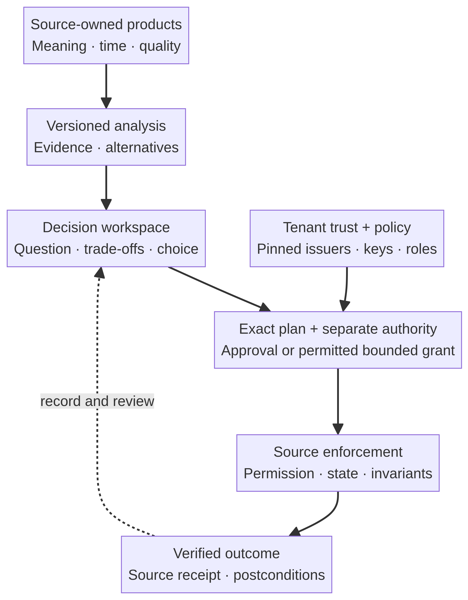
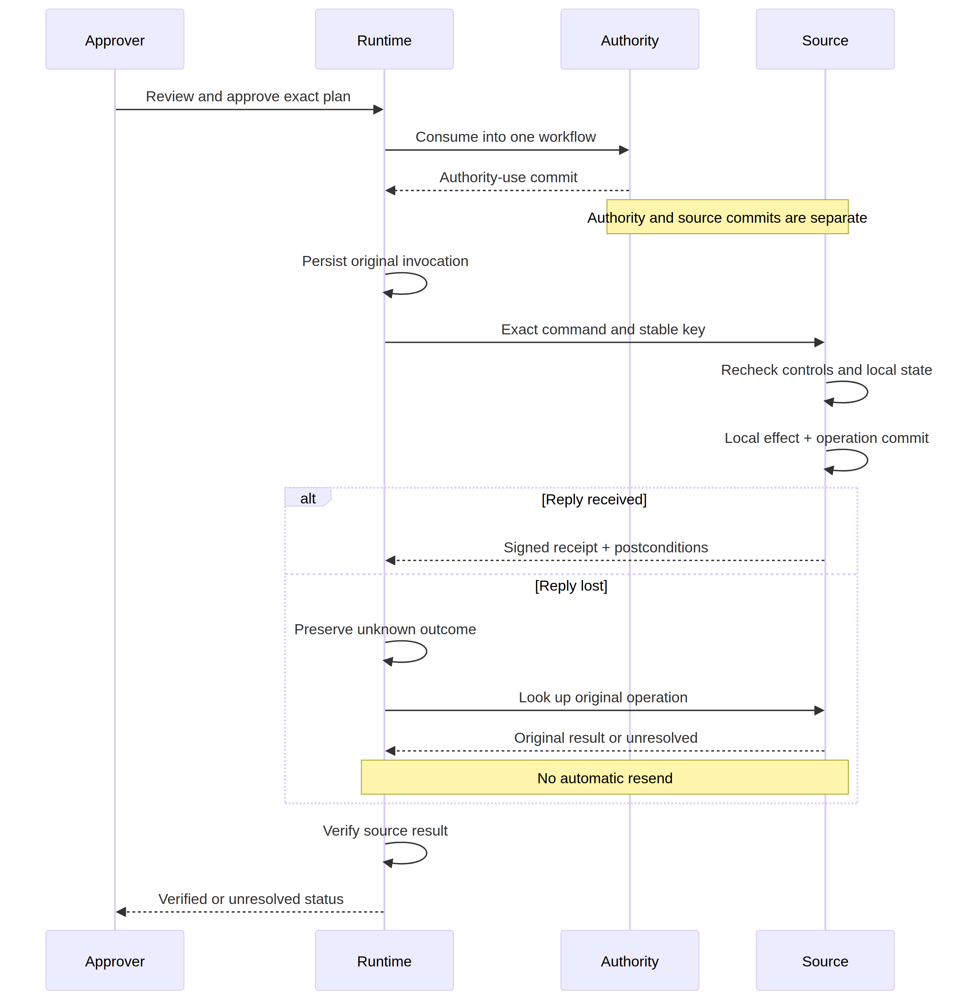

# Source-Owned Data, Decisions and Actions

## APS-DDA: a proposed participation profile for governed analytical workflows

**Public technical edition — working draft**  
**Author:** Kunal Yadav  
**Copyright:** © 2026 Kunal Yadav  
**License:** [CC BY 4.0](../LICENSES/CC-BY-4.0.txt); see [scope and third-party exceptions](../LICENSING.md)  
**Edition date:** 3 November 2026  
**Specification discussed:** APS-DDA v0.1, proposed and unratified  
**Implementation discussed:** experimental .NET/C# reference binding for selected requirements

This paper is a technical proposal, not a ratified standard, security certification, actuarial assessment, production deployment, or evidence of economic advantage. The [proposed standard](../spec/APS-DDA-v0.1.md) is language-neutral. The .NET implementation is one experimental binding, not the definition of the standard and not a complete conformance implementation. Concrete coverage and gaps are recorded in [implementation status](implementation-status.md), [architecture](architecture.md), and the [API contract](../API_CONTRACT.md).

The [16 October 2026 paper](original/technical-white-paper.md) retains its technical content and procurement example; its preparation header is generalised in this distribution. This edition changes the central explanatory story to cross-system insurance analytics and distinguishes the richer analytical design from the existing contract core. The new source code was developed with AI assistance. Draft preparation, code inspection, and automated tests must not be represented as human expert sign-off or external peer review. Existing third-party notices remain applicable to their respective materials.

## Abstract

For a bounded class of cross-system operational decisions, an organization should not have to build a **new analytical replica, bespoke decision application, and disconnected action bridge** before it can turn a business question into a governed result. Source systems can instead publish usable data products and named business-process capabilities. A decision platform composes them into an inspectable loop:

**intent → evidence → analysis → decision → exact plan → authority → source action → verified outcome**.

The ambition is analytical as well as transactional. A planner can compare regional demand, model assumptions, capacity alternatives and funding constraints inside the same platform that retains the decision, obtains exact approval, and verifies subsequent source actions. The system is not merely a local CRUD endpoint with a conversational front end. Equally, it does not abolish domain models, durable history, materialized products, governed copies, identity engineering, or specialist analytical services.

APS-DDA v0.1 proposes a common participation profile for this loop. It specifies candidate contracts, artifacts and externally observable obligations over HTTPS rather than a new networking layer or a mandatory agent implementation. LLMs, deterministic adapters, rules engines, workflow services and vendor-native components can participate. MCP and A2A are useful substrates for connectivity and delegation; they are not inherently incapable of governed action. The additional proposal is a portable set of semantic, exact-authority, source-control and outcome-recovery commitments.

The reference code implements selected integrity, trust and durable action-lifecycle controls using the unchanged original schema. Its local SQLite effects and synthetic data demonstrate mechanics, not a live insurer integration or a proven replacement for an analytical platform. A fuller insurance analytical/domain extension remains outside the defined core and requires its own reviewed contracts, model validation and interoperability evidence.

## 1. The replacement objective and its boundary

The desired outcome is to remove the requirement for a **new bespoke** ingestion/model/dashboard/disconnected-action chain for a supported workflow. A user should be able to ask an operational question, inspect evidence and numerical alternatives, choose a plan, approve its exact effect, and see what the sources actually did without manually translating a dashboard into a different action system.

This is not a claim that warehouses, lakehouses, semantic layers or integration systems are inherently wrong. Reusing an existing governed analytical product is compatible with the proposition. So is publishing a deliberate materialized product when history, throughput, residency, reproducibility, reconciliation or workload isolation requires it. Calling a conventional warehouse with an agent front end a replacement, while leaving the decision and action disconnected, is not enough.

A replacement claim is meaningful only for named workflows with agreed source load, latency, semantics, security, recovery and audit requirements. Suitable candidates have bounded evidence scope, reviewed analytical methods and named operational commands. Unconstrained exploration, enterprise-wide historical BI, model training, unresolved identity reconciliation and cross-system atomic commitment are not promised by this profile. If published source products cannot meet the workflow's requirements, the correct answer is an existing or new governed analytical product, a safe narrower path, or abstention.

The proposal shifts work; it does not eliminate it. Sources must publish and maintain meaningful contracts. A tenant must provision trust, identity, policy and recovery ownership. Model owners must explain and validate their methods. Evaluation must measure these costs alongside any avoided central-stack work.

## 2. Existing protocols are substrates, not adversaries

This edition retains the original paper's checked citations and named revisions as **historical documentation anchors**, not assertions that they are the latest releases. Mutable documentation URLs are not release locks. A concrete binding must pin its actual protocol and extension versions and retest compatibility.

MCP revision **2026-07-28** is a valuable substrate. Its official release announcement states that the revision was released on 28 July 2026; the specification uses stateless, self-describing requests and supports resources, prompts, and tools in a host/client/server model. [1] [2] Tools can declare JSON Schema input and output schemas, and when an output schema is declared the server’s structured content must conform. [3] This is a useful type boundary. MCP also permits mutating tools; its tools guidance expects servers to validate inputs, implement access controls and rate limits, while clients should confirm sensitive operations and audit use. It would be inaccurate to claim that MCP cannot write. [3]

The same revision has an optional HTTP authorization profile using OAuth-oriented protected-resource metadata, resource indicators, and audience validation. [4] It has optional client interaction through Multi Round-Trip Requests, and its former experimental Tasks work is an opt-in `io.modelcontextprotocol/tasks` extension. [1] [5] These mechanisms are useful for a host calling a source service. They do not, on their own, require shared domain meaning, approval bound to an ordered command graph, or evidence of an external effect.

A2A **v1.0**, announced on 12 March 2026 as the first stable, production-ready release, is also useful rather than a strawman. [6] Its task model, artifacts, task updates, and agent descriptions provide a credible cross-agent delegation envelope. The specification’s task states include `SUBMITTED`, `WORKING`, `INPUT_REQUIRED`, `AUTH_REQUIRED`, `COMPLETED`, `FAILED`, `CANCELED`, and `REJECTED`. [7] The cited detailed route is mutable `/latest/` documentation, so an implementation must pin its selected A2A version and binding rather than use that route as a release lock. An A2A Agent Card can advertise skills, interfaces, and security requirements. The discovery material allows well-known cards and curated registries, but does not prescribe a standard curated-registry API. [8]

A skill description does not prove that its publisher is authoritative for a metric or entitled to change a resource. A generic artifact does not define the business receipt, state guard, approval scope or duplicate behavior. A2A’s `AUTH_REQUIRED` state usefully signals an authorization dependency, but the v1 specification expressly leaves the scope, representation, validity, and revocation of resulting authorization to implementation. [7]

The limited conclusion is that **unprofiled connectivity alone does not establish this paper's end-to-end claim**. MCP tools can carry APS-DDA contracts, use deterministic services and issue receipts. A2A tasks can carry the same artifacts and delegate their processing. Vendor-native agents can be wrapped by source-authorized adapters. Once the necessary commitments are mandatory, externally visible and tested, the implementation supplies an APS-DDA-like participation profile over that substrate. The current reference project does not implement MCP or A2A adapters merely because the original schema names those bindings.

## 3. Source products, business capabilities and divided responsibility

A **Data Product Contract** is a source-owned, versioned commitment: owner and authoritative scope; schema and semantic identifiers; grain, entity and temporal meaning; lineage; permitted purpose, classification and entitlement; quality, freshness and observation conditions; correction/history behavior; query shapes and budgets; residency, retention and compatibility. A product may be authoritative, derived or observational. A forecast is authoritative for what a particular model issued, not proof of future events.

This aligns with, but is not replaced by, existing data-contract and semantic-layer work. Data mesh describes domain interfaces as containing operational capabilities as well as analytical endpoints, and describes a data product as code, data/metadata, and infrastructure. [9] Open Data Contract Standard (ODCS) **v3.2.0** is a platform-agnostic contract structure with sections such as schema, context, quality, roles, SLA, infrastructure, and authoritative definitions. [10] dbt’s Semantic Layer documents centralized metric definitions, automatic joins, and options to materialize or cache metrics. [11] None of those cited mechanisms alone supplies portable, source-enforced authority for a consequential command. They demonstrate useful antecedents rather than an empty field.

A **Process Capability Contract** is separate. It names a source-owned business operation, not arbitrary mutation: an internal capacity-readiness reservation or preparation of a notification draft, rather than a generic `PATCH` or client-selected SQL statement. It declares command meaning, input/result schemas, resource scope, source permission and separation-of-duties checks, preconditions and invariants, risk, authority requirements, idempotency and lookup, receipt, cancellation and compensation or non-compensability. Google AIP-136 gives a related design rationale for custom methods when an action does not fit standard resource methods. [12]

Named commands make an effect inspectable; a shared name does not prove that two sources implement identical business rules. Each source remains accountable for its binding and enforcement boundary.

The architecture separates five responsibilities:

| Responsibility | Permitted contribution | Not a substitute for |
| --- | --- | --- |
| Intent/coordinator | Clarify the question, locate permitted products, assemble candidates and coordinate progress | Source permission or business authority |
| Specialist analytical service | Calculate forecasts, constraints and alternative outcomes using a reviewed, versioned method | Source fact ownership or mutation permission |
| Trusted control/execution plane | Verify exact contracts/evidence, evaluate policy, bind plans, admit/consume authority, dispatch and reconcile | Source-local invariant enforcement |
| Source publisher/executor | Publish bounded products and own the final business-state transition and operation record | Cross-source atomicity unless explicitly provided |
| Renderer/compiler | Present evidence, assumptions, alternatives, exact payload and truthful status; derive constrained UI artifacts | Policy, entitlement, approval authentication or source receipts |

A tenant-controlled directory pins participant identity, key, role, profile, contract digest, endpoint/audience and semantic permissions. Discovery is not trust. Neither a self-published manifest nor retrieved text may install a key, alter a policy or register a source command. The [architecture diagrams](architecture.md) distinguish the proposed ecosystem from the local implementation.

*Figure 1. The proposed participation loop. Analytics, business authority and source execution remain distinct responsibilities; the figure is not a claim that every component is implemented by the reference project.*

## 4. Central walkthrough: insurance readiness across systems

### 4.1 The analytical question

Consider a fictional regional operations planner asking:

> Compare next-period flood-related workload across North, Central and South. Show capacity and planning-budget alternatives, preserve minimum service coverage and a contingency reserve, and prepare only the internal readiness actions I approve.

This is not automated claims adjudication, customer entitlement, fraud determination, policy pricing or payment. No real policyholder data or customer contact is needed. The decision concerns synthetic internal readiness. The point is to join meaning and analytical trade-offs to governed action, not to demonstrate that a local resource can be updated.

The platform resolves separately owned products: claims aggregates for current backlog; a flood-forecast product for projected arrivals and its scenario assumptions; a staffing/capacity product for existing throughput and deployable units; and a finance/planning product for available internal budget. The returned evidence pins products, semantic versions, observation times, quality and protected values. Region IDs, reporting period, grain and units must be explicitly compatible. A forecast's projected arrivals cannot silently be treated as observed claims, and a planning credit cannot be presented as a payment authorization.

The combined evidence is **observational** unless a documented coordinated product covers all sources. A common orchestration timestamp is not a global snapshot. If freshness, region mapping, reporting period or a required hard constraint cannot be established, the decision is clarification, ineligibility or manual review rather than a fluent guess.

### 4.2 A reproducible illustrative comparison

The following small worked example is invented solely for this paper. It is **not a dataset or output assertion about the console demo**. Its arithmetic was checked by exhaustive integer enumeration. All periods, units, weights and limits below are explicit assumptions, not validated insurance parameters.

For one synthetic planning period, let `x[r]` be additional internal capacity units allocated to region `r`. Each unit contributes ten workload completions. The model projects end-period backlog as:

`L[r] = max(0, B[r] + A[r] - C[r] - 10*x[r])`.

Here `B` is current backlog, `A` is scenario arrivals and `C` is baseline completions. The reviewed objective for this example is to minimize `2*L[North] + 3*L[Central] + L[South]`; the larger Central weight is a declared planning preference, not a fact inferred by an agent.

| Input | North | Central | South |
| --- | ---: | ---: | ---: |
| Current backlog `B` | 100 | 80 | 60 |
| Scenario arrivals `A` | 40 | 80 | 20 |
| Baseline completions `C` | 70 | 60 | 50 |
| Minimum additional units | 1 | 2 | 1 |
| Maximum additional units | 4 | 6 | 3 |
| Cost per additional unit, in synthetic planning credits | 2 | 3 | 1 |
| Objective weight | 2 | 3 | 1 |

There are nine shared units, of which at least three remain unallocated as contingency. Thus `sum(x) <= 6`. The planning-credit cap is 16: `2*x[North] + 3*x[Central] + x[South] <= 16`. Units are integers within the stated regional minima/maxima. A finite enumerator evaluates every feasible tuple; ties are resolved by lower cost, then lexicographic regional allocation. There are ten feasible tuples under these assumptions.

| Alternative | Additional units N/C/S | Credits | Projected backlog N/C/S | Weighted backlog |
| --- | --- | ---: | --- | ---: |
| A: balanced incremental coverage | 2 / 3 / 1 | 14 | 50 / 70 / 20 | 330 |
| B: priority to Central | 1 / 4 / 1 | 15 | 60 / 60 / 20 | 320 |

B is the minimum-score feasible allocation in this toy model. It costs one more credit than A and leaves more North backlog while reducing the more heavily weighted Central backlog. Both allocate six units and preserve the three-unit contingency. This is a numerical alternative comparison, not simply a boolean eligibility check. The recommendation should show the trade-off and permit an accountable human to choose a different feasible alternative, with the selected alternative recorded in a new exact plan.

The uncertainty is equally important: scenario arrivals may be wrong, productivity is simplified as constant, regional weights may be inappropriate, and evidence observations are not synchronized. A real analytical profile needs sensitivity/scenario analysis and domain review. If a probabilistic method is used, it needs retained input versions, distribution/model/parameter versions, sampling algorithm and seed where relevant, reproducible computation, and appropriate uncertainty reporting. Deterministic replay does not validate the underlying model.

### 4.3 From calculation to an exact, bounded operational plan

The specialist calculation supplies a **DecisionSpec**: accountable owner, question, objective, hard constraints, alternatives, exact evidence references, method type/version/parameter digest, assumptions, uncertainty, recommendation and action eligibility. The platform retains the actual parameters and results under an explicitly defined external resource or reviewed domain extension. A digest of inaccessible parameters is not reproducibility.

Selecting an alternative creates an immutable **ExecutionPlan**. Each step pins a source capability, resolved target, effect-bearing payload commitment, expected version, evidence, expiry, idempotency key/fingerprint and recovery owner. A proposed regional allocation command must bind the complete allocation, not merely its aggregate total. If the selected source only supports an aggregate capacity reservation, its receipt proves that aggregate reservation, **not** that the three regions have been staffed, the finance budget has been spent, or the predicted backlog has fallen.

The current reference `ReserveCapacityCommand` supports only an aggregate canonical integer quantity; `PrepareNotificationDraftCommand` increments an internal draft count and sends nothing. They are useful selected lifecycle demonstrations. Regional assignment, actuarial forecasting, finance encumbrance and external notification delivery are not thereby implemented. A richer source-owned command would need its own reviewed schema, semantic validator, guards and receipt/postconditions. The platform must not relabel the aggregate demonstration as a complete insurer readiness deployment.

The human route shows the authenticated independent approver the alternatives, assumptions and **complete retained normalized payload**, as well as the plan digest and permitted steps. The approved artifact binds the exact plan and policy decision, expires, and is consumed into one durable workflow. A separately configured low-risk internal policy route can use a bounded Policy Grant, but only where the source allows it and actually checks resource, capability, audience, quantity, rate and time limits. A policy `allow` outcome never grants execution authority by itself.

Immediately before each effect, the source verifies current caller permission, exact plan/authority, evidence and policy conditions, expected local state and its own invariant. An external hard budget or capacity invariant needs a source-owned guard or declared coordination mechanism. Re-reading finance and capacity does not eliminate a race. If the required cross-source guarantee is absent, that action remains unsupported or is narrowed to a non-binding internal preparation step.

Completion is about the actions actually performed. Signed source receipts and verified postconditions can show capacity reserved or a draft prepared. They cannot prove future claim volumes, forecast accuracy, customer service improvement or business value. Those require later observational products and an appropriate evaluation method.

## 5. What the core defines—and what it does not

The unchanged v0.1 bundle defines fifteen artifact types, exact typed references, immutable headers, dedicated body extensions, a DecisionSpec, ExecutionPlan, PolicyDecision, Approval/Authority, invocation, receipt, ApplicationSpec and BuilderPrompt. It supplies the contract skeleton and normative behavior for a governed loop. JSON Schema validates shape and local syntax only.

A fuller analytical/domain profile is **not defined by the core**. In particular, the current schema's DecisionSpec uses strings for objectives, constraints, alternatives, assumptions and recommendations, plus a method type/version/parameter digest. It does not provide a universal machine-readable optimization language, model registry, scenario matrix, currency/calendar ontology, fairness definition, identity resolver or insurance vocabulary. The paper's broader analytical design must not be read as though these already have standardized interoperable fields.

A future reviewed extension could define structured model inputs/results, cohort/region/time/unit mappings, optimizer objectives, scenario lineage, sensitivity output and chosen-allocation commitments. That requires a versioned proposal with byte rules, deterministic validators, source semantics, compatibility and adversarial tests. It must use the existing extension mechanism or a new explicitly versioned profile, not silently insert fields into closed v0.1 bodies. URI-naming alone does not establish trust or semantic equivalence. This reference binding refuses every unknown or unversioned extension, even one marked non-critical, as an explicitly stricter experimental acceptance policy.

Similarly, raw normalized command payloads are carried in a separate documented runtime binding because the original plan/command bodies contain `payloadDigest`, not a raw payload field. The capability's pinned endpoint defines the audience. The .NET detached signature envelope and invocation-fingerprint convention are experimental bindings; they are not additional normative artifact types or a claim that v0.1 mandated those exact envelope bytes.

## 6. Integrity and execution context

The immutable artifact content digest covers the complete artifact minus **only** `/header/contentDigest`:

`contentDigest = "sha256:" + lowercase_hex(SHA256(JCS(artifact_core)))`.

The ExecutionPlan digest covers the complete artifact minus **only** `/header/contentDigest` and `/body/planDigest`:

`planDigest = unpadded_base64url(SHA256(JCS(plan_core)))`.

JCS supplies UTF-8 bytes. The plan digest encodes 32 bytes as 43 unpadded base64url characters. Insert it before computing content digest. Every other field—including header, complete context, extensions and ordered steps—is covered. Detached signatures, credentials, mutable status and transport attempts stay outside these immutable projections. RFC 8785 defines JCS for deterministic JSON serialization, but it is an informational canonicalization specification, not a policy or semantic standard. [16]

Hashing binds declared bytes, not truth, wisdom, freshness or authority. Different source facts can have valid hashes; a correctly signed forecast can be wrong. Implementations must reject duplicate decoded member names and ambiguous input. Exact money, precision quantities and large IDs use profile-defined canonical strings. JCS does not normalize arbitrary identifiers, Unicode or URIs; authorization-bound identifiers must not be normalized into equivalence afterward.

The ExecutionContext binds tenant, authenticated subject, workload/client, executor, purpose, correlation UUID and exact policy references, with classification/residency or delegation where applicable. In v0.1 the correlation UUID is the durable workflow identity. Request context is a claim to compare with the authenticated principal, not an identity source. Effective source permission intersects caller/delegation, source entitlement, resource/tenant, classification, purpose, residency, contract and current policy. The selected runtime refuses delegation rather than pretending to validate it.

Audience restriction is a useful lower-layer control. RFC 8707 defines OAuth resource indicators, and RFC 9700 recommends least privilege, audience restriction, and refusal of a token not intended for the resource server. [13] [14] MCP’s 2026-07-28 HTTP authorization profile similarly requires the target resource and intended-audience validation where that profile is used. [4] Authentication, source authorization, policy evaluation and business authority nevertheless remain distinct checks. The current runtime's administrator-provisioned principal handles do not implement a production OAuth or mTLS identity provider.

## 7. Policy evidence, business authority and source enforcement

A **PolicyDecision** records a pinned evaluation, outcome and obligations. `deny` or `indeterminate` blocks action; `allow` or `allow-with-human-approval` is still evidence, not a mutation grant. The selected `EligibilityPolicy` is a small deterministic evaluation of DecisionSpec eligibility, not an analytical model or general insurer entitlement engine.

A human **Approval** binds the authenticated approver, exact plan reference/digest, policy decision, permitted step set, effect summary, issuance, expiry and single-use condition. A **Policy Grant** is an alternative only where a named source/risk profile permits it, with actual source-bound resource, quantity/amount where supported, rate, time, evidence and revocation checks. A chat acknowledgement, UI checkmark, OAuth consent or A2A authorization-dependency state does not automatically establish either artifact's business meaning.

The authority service atomically consumes authority into one durable workflow, plan and allowed step set before dispatch. This is a **local authority-store transaction**, not a transaction with a source action. A crash afterward recovers that binding, not a fresh workflow or new key. Each later step rechecks current expiry, revocation and source permission. OWASP guidance makes the same core point: agent authorization belongs outside the agent context; a simple `user_confirmed` flag is insufficient, and approval must match the actor and exact tool call, expire, and be atomically consumed. [17]

The source remains the final enforcer. It checks expected state with the effect, not merely at planning time. HTTP `If-Match` is a standard conditional mechanism: a false condition prevents the method from being applied. [18] Equivalent mechanisms must declare their comparison semantics. The SQLite reference binding uses a source-local version checked inside its effect transaction. That protects its own resource, not independent finance or forecast state.

The reference source updates its local resource, inserts the operation record and retains signed receipt/postcondition evidence in one local transaction. A wrapper around an external API cannot manufacture this source-local guarantee unless the source itself provides it. Production adapters must demonstrate their own operation/effect durability and authoritative lookup.

## 8. Unknown outcomes, idempotency and partial work

A command publishes its idempotency domain, key rules, retention, fingerprint, duplicate behavior and operation lookup. Same key plus same fingerprint returns the original operation/receipt without another effect; a different fingerprint conflicts. Signature bytes are not the operation identity.

RFC 9110 permits automatic retry after a communication failure for idempotent methods, but cautions against retrying non-idempotent methods unless the client knows the request is idempotent or can detect non-application. [18] APS-DDA requires an ambiguous operation to remain unknown while the executor queries the original operation/key before any permitted resend. It must not invent a new key or infer no effect from a timeout.

The selected runner persists the original invocation and `UNKNOWN` intent before source transport. After a lost reply, it queries the original identity and verifies source-issued results. It **never automatically resends**, even after lookup returns not-found. This conservative subset leaves absent or ambiguous outcomes for the named manual owner; it does not implement every retransmission path permitted by the proposal.

Completion requires exact invocation/receipt/postcondition links, the actual configured source issuer and valid source signatures, original durable operation identity, resource version and verified source-local transition. A successful HTTP response, LLM explanation or generic terminal task label is insufficient. A signed but incorrectly bound receipt also cannot complete the workflow.

*Figure 2. Selected reference execution and lost-reply recovery. Authority use and source effects commit separately. A missing or unverifiable result stays unresolved; the runner does not automatically resend.*

A multi-source workflow is not thereby atomic. A saga coordinates local transactions with compensations and provides eventual consistency; intermediate states can be visible, compensations can fail, and the pattern is unsuitable when an operation must appear as an atomic cross-service commitment. [19] The current runner implements explicit non-compensability with accountable manual ownership, not automatic compensation. A second-source refusal retains the first effect and reports manual resolution. Cancellation stops future steps; it does not undo a committed reservation or notification. Unknown effects remain unknown until reconciled.

## 9. Data locality, historical products and consistency

Source ownership is not a zero-copy promise. Bounded results, encrypted working sets, caches, query exchange/spill, replication, history and disaster recovery may legitimately move data. A declared materialized product should expose owner, source/semantic and transformation versions, watermark/as-of time, classification, purpose, region, retention and invalidation. It must not be an undisclosed shadow warehouse.

Federation must be selected by evidence, not slogan. Trino documents that predicate, projection, aggregation, limit, top-N, and join pushdown depend on connector and source; a pushed join requires tables in the same catalog and pushable predicates, and `EXPLAIN` is needed to verify execution. [20] The planner should use declared query shapes and budgets, record its actual plan when available, and select a published materialized product when a recurring join cannot meet source load or latency requirements.

Temporal meaning is equally important. Delta Sharing exposes per-table version/timestamp interfaces, with history/time travel dependent on whether history sharing is enabled. [21] That supports per-product temporal evidence; it does not establish a heterogeneous global snapshot. Cross-region and cross-cloud sharing can also require replication, as Snowflake’s documentation explains. [22] A decision that truly requires one temporal cut must use a tested coordinated product or abstain. It must not manufacture atomicity through a common orchestration timestamp.

Identity resolution remains a governed responsibility. Data mesh identifies unified identification across domains as a global concern. [9] Product contracts need authoritative IDs and permitted mappings, with match confidence, purpose, merge/split, survivorship and deletion limits. The orchestrator cannot equate locally scoped identifiers because they look alike.

Long-horizon analytics, training, recurrent high-volume joins, reconciled history and legal retention may justify durable engineered products. The proposal permits them. Its goal is to avoid unnecessary **new replicas and disconnected action layers**, not necessary analytical models and history.

## 10. Threat model and generated presentation

User requests, retrieved source text, documents, tool descriptions, prompts and inter-agent messages are untrusted instructions. Even signed text attests bytes and origin, not a right to change policy. OWASP warns that indirect prompt injection can arrive through retrieved documents and API content, and that authorization must be enforced outside the agent context. [17] NIST similarly describes agent hijacking as indirect prompt injection exploiting inadequate separation of trusted instructions and untrusted data. [23]

The trusted control plane must prevent such content from replacing keys, policy, semantic bindings, plan fields, authority, source preconditions or source invariants. A deterministic demo that ignores malicious text demonstrates only its selected path; it is not a comprehensive assessment of an LLM-enabled deployment.

An **ApplicationSpec** pins a DecisionSpec, exact ExecutionPlan, reviewed component catalog and typed evidence/action mappings. A **BuilderPrompt** is derived, versioned and non-authoritative. Neither gets broad source credentials, arbitrary code execution or hidden commands. Schema-constrained model output is a syntax aid, not proof that the decision is correct or complete. [15]

Builder-specific application generation belongs on the same boundary. v0 documents a code and GitHub delivery path with branches, previews, CI, pull requests, and branch protection. [29] These are useful delivery practices, not a business-authorization model. Generated code still needs ordinary review, tests, dependency/security assessment and accountable release ownership. A generated approval control does not authenticate an approver or become a source receipt. This project does not claim to have deployed a generated application merely by issuing such artifacts.

Controls can still fail through a mis-specified contract, incorrect source fact, bad policy, compromised source/key or poor human judgment. The profile makes obligations inspectable and required refusals explicit; it does not promise universal safety or legal compliance.

## 11. What the .NET reference evidence establishes

`ApsDda.Core` accepts the full unchanged original schema offline, maintains immutable snapshots and exact references, computes actual JCS/content/plan digests, and implements a documented experimental P-256 detached signature envelope and tenant trust pins. It uses pinned upstream canonicalization source with retained provenance/notices. Its strict input profile is narrower than general RFC 8785: object/array roots, safe-number magnitude limits and canonical string recommendations are documented rather than disguised as complete unrestricted JCS input support.

`ApsDda.Runtime` retains original signed artifacts, protected evidence, authority admissions/use, workflows, normalized payloads, original invocations/receipts, source state/operations, current policy and local revocations in file-backed SQLite. It revalidates configured source evidence semantics and freshness, policy, exact authority and source permission. Its selected commands mutate synthetic internal capacity or draft counts. Two independently signed **logical** sources are tested; their local test storage is not a real external-system integration.

On 3 November 2026, the integrated locked restore and Release build passed with zero warnings/errors on local Linux SDK `10.0.403`. **368 xUnit cases passed, zero failures/skips: Core 130, Runtime 85, HTTP 89, Demo 44 and cross-module Acceptance 20.** All 13 supported console scenarios ran. Actual loopback Kestrel and the typed-client synthetic approval replay passed; a fresh outside-checkout consumer using locally packed NuGet packages exercised embedded schema/digest/signature validation, authenticated exact approval admission/consumption, a SQLite effect, verified original source receipts/postconditions, duplicate no-extra-effect and durable reopen. These are selected local test cases, not external interoperability, real human approval, independent security review or production evidence. One Core case covers 10,000 V8 number vectors; those are not 10,000 separately counted tests. Windows and remote GitHub CI results remain unverified until actual runs are recorded.

The [status matrix](implementation-status.md) is the coverage authority for this edition. HTTP, analytical demo/compiler and acceptance coverage above comes from their actual integrated tests, not an inference from Core/Runtime counts. Production identity integration, durable trust/principal provisioning, key storage/rotation, encrypted storage/retention, distributed revocation, general read negotiation/budgets, coordinated snapshots, cross-source atomicity, automated compensation, external-source interoperability and full conformance are not established by this evidence.

## 12. Prior art, adoption and falsifiable evaluation

The proposal should not claim to invent the data-to-decision-to-action loop. Palantir documents Foundry’s Ontology as an operational layer over datasets, virtual tables, and models, with semantic elements and actions, functions, and dynamic security; its action types describe transactions, validation, side effects, and writeback. [24] [25] Palantir AIP documents agents and workflows on top of that model. [26] A customer already using that environment may reasonably prefer its native architecture for a local loop.

Salesforce also documents Agentforce custom action paths and Data 360’s ingestion, mapping, transformation, identity-resolution, and activation paths through agents, flows, webhooks, and APIs. Its documented zero-copy connectors are read-only. [27] [28] These features disprove any suggestion that vendor platforms lack governed actions or integration. They also illustrate why it would be wrong to promise the end of all data movement and transformation.

The proposed distinction is neutral participation across independently operated products and agents, with versioned meaning, tenant trust, bounded authority, source receipts and recovery. That is a design proposal, not proof of uniqueness, superior economics or a durable moat. A vendor-native platform can participate. Adoption should depend on measured interoperability benefits versus source-publishing and control-plane costs.

A pilot should compare the same named sources, identities, policies and preregistered cases in plausible baseline arms: an existing engineered analytical/manual-action path; isolated source agents with human reconciliation; typed MCP tools without mandatory cross-domain profile obligations; and APS-DDA using a suitable pinned binding. Each retains manual fallback. Test identity/grain/time/unit ambiguity, version drift, non-aligned observations, permission denial, quotas, late correction, stale writes, lost replies, duplicate delivery, revocation and partial failure.

Measure engineering effort and changes, source impact, moved bytes/copy footprint, adjudicated analytical correctness, appropriate abstention, reproducibility, authority violations, stale/duplicate effects, receipt coverage, recovery time, human reconciliation and source-owner burden. For the insurance walkthrough, also evaluate whether scenario/weight changes alter the selected alternative appropriately and whether projected outcomes remain visibly separate from verified actions. No ROI, service improvement or performance result is claimed here.

The thesis fails for a workflow if source contracts cannot meet its history, semantics, load, latency or recovery requirements; if every new decision still needs a bespoke central model/dashboard/manual action bridge; or if the added publishing/control-plane burden exceeds avoided work. Passing fixtures establishes declared behavior only, not business success.

## Conclusion

APS-DDA proposes an inspectable operating loop in which source products support genuine analysis and source-owned capabilities carry out exact, separately authorized plans. Its objective is to avoid an unnecessary new analytical replica and disconnected action layer—not to eliminate all copies, models or historical products, and not merely to rename local CRUD.

The insurance walkthrough illustrates the necessary distinction: a reproducible cross-region recommendation, a plan-bound authority decision, and a verified source action are three different things. A forecast is not truth, policy evaluation is not a grant, a digest is not permission, and a completed reservation is not proof of future workload improvement.

MCP and A2A can reduce adoption work as useful substrates. The standard remains a language-neutral working draft; the .NET/C# code is an experimental selected-subset reference. Fuller analytical/domain contracts, production controls, independent interoperability, expert review and empirical comparisons remain work to be done through a versioned proposal and contribution process.

## References

The following definitions are retained unchanged from the original paper. Their named revisions and release descriptions are historical anchors, not a refreshed latest-version survey.

[1]: https://blog.modelcontextprotocol.io/posts/2026-07-28/ "The 2026-07-28 Specification"

[2]: https://modelcontextprotocol.io/specification/2026-07-28 "Model Context Protocol Specification, revision 2026-07-28"

[3]: https://modelcontextprotocol.io/specification/2026-07-28/server/tools "MCP Server Tools, revision 2026-07-28"

[4]: https://modelcontextprotocol.io/specification/2026-07-28/basic/authorization "MCP Authorization, revision 2026-07-28"

[5]: https://modelcontextprotocol.io/extensions/tasks/overview "MCP Tasks Extension Overview"

[6]: https://a2a-protocol.org/latest/blog/2026/03/12/a2a-protocol-ships-v10-production-ready-standard-for-agent-to-agent-communication/ "A2A Protocol Ships v1.0: Production-Ready Standard for Agent-to-Agent Communication"

[7]: https://a2a-protocol.org/latest/specification/ "Agent2Agent (A2A) Protocol Specification"

[8]: https://a2a-protocol.org/latest/topics/agent-discovery/ "Agent Discovery in A2A"

[9]: https://martinfowler.com/articles/data-mesh-principles.html "Data Mesh Principles and Logical Architecture"

[10]: https://bitol-io.github.io/open-data-contract-standard/v3.2.0/ "Open Data Contract Standard v3.2.0"

[11]: https://docs.getdbt.com/docs/use-dbt-semantic-layer/dbt-sl "dbt Semantic Layer"

[12]: https://google.aip.dev/136 "Google AIP-136: Custom Methods"

[13]: https://www.rfc-editor.org/rfc/rfc8707.html "RFC 8707: Resource Indicators for OAuth 2.0"

[14]: https://www.rfc-editor.org/rfc/rfc9700.html "RFC 9700: Best Current Practice for OAuth 2.0 Security"

[15]: https://ai-sdk.dev/docs/ai-sdk-core/generating-structured-data "AI SDK: Generating Structured Data"

[16]: https://www.rfc-editor.org/rfc/rfc8785.html "RFC 8785: JSON Canonicalization Scheme"

[17]: https://cheatsheetseries.owasp.org/cheatsheets/AI_Agent_Security_Cheat_Sheet.html "OWASP AI Agent Security Cheat Sheet"

[18]: https://www.rfc-editor.org/rfc/rfc9110.html "RFC 9110: HTTP Semantics"

[19]: https://docs.temporal.io/design-patterns/saga-pattern "Temporal Saga Pattern"

[20]: https://trino.io/docs/current/optimizer/pushdown.html "Trino Pushdown"

[21]: https://raw.githubusercontent.com/delta-io/delta-sharing/main/PROTOCOL.md "Delta Sharing Protocol"

[22]: https://docs.snowflake.com/en/user-guide/secure-data-sharing-across-regions-platforms "Snowflake Cross-Region and Cross-Cloud Data Sharing"

[23]: https://www.nist.gov/news-events/news/2025/01/technical-blog-strengthening-ai-agent-hijacking-evaluations "NIST Technical Blog: Strengthening AI Agent Hijacking Evaluations"

[24]: https://palantir.com/docs/foundry/ontology/overview/ "Overview: Ontology — Palantir Foundry"

[25]: https://palantir.com/docs/foundry/action-types/overview/ "Action Types: Overview — Palantir Foundry"

[26]: https://palantir.com/docs/foundry/aip/overview/ "Overview: AIP — Palantir Foundry"

[27]: https://developer.salesforce.com/docs/ai/agentforce/guide/get-started-actions.html "Build and Enhance Agentforce Actions"

[28]: https://developer.salesforce.com/docs/data/data-cloud-dev/guide/dc-architecture.html "Data 360 Architecture"

[29]: https://v0.app/docs/github "v0 GitHub Documentation"
